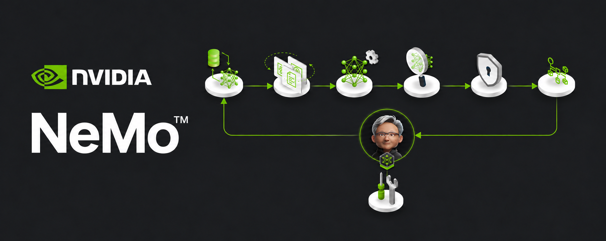

### Featured repositories · November 2026

<table>
  <tr>
    <td width="50%" valign="top">
      <h3><a href="https://github.com/NVIDIA-NeMo/Safe-Synthesizer">NeMo Safe Synthesizer</a></h3>
      
🛡️ NeMo Safe Synthesizer: Create private, safe versions of sensitive tabular datasets.

    </td>
    <td width="50%" valign="top">
      <h3><a href="https://github.com/NVIDIA-NeMo/Switchyard">NeMo Switchyard</a></h3>
      
Switchyard lets LLM applications route traffic across models and providers while preserving native OpenAI and Anthropic API compatibility - enabling flexible model selection, benchmarking, and cost/performance optimization.

    </td>
  </tr>
  <tr>
    <td width="50%" valign="top">
      <h3><a href="https://github.com/NVIDIA-NeMo/eval-author">NeMo Eval Author</a></h3>
      
Research preview: skills that help your coding assistant build evaluations for custom agents, assess the quality of existing suites, and find behavior-coverage gaps. Works today with NeMo Gym and Harbor.

    </td>
    <td width="50%" valign="top">
      <h3><a href="https://github.com/NVIDIA-NeMo/labs-molt">NeMo Labs Molt</a></h3>
      
A scalable, agentic-first, and HuggingFace-native RL framework for research (9k lines).

    </td>
  </tr>
  <tr>
    <td width="50%" valign="top">
      <h3><a href="https://github.com/NVIDIA-NeMo/Lens">NeMo Lens</a></h3>
    </td>
    <td width="50%" valign="top">
      <h3><a href="https://github.com/NVIDIA-NeMo/Nemotron">Nemotron</a></h3>
      
Developer Asset Hub for NVIDIA Nemotron — A one-stop resource for training recipes, usage cookbooks, datasets, and full end-to-end reference examples to build with Nemotron models

    </td>
  </tr>
</table>
